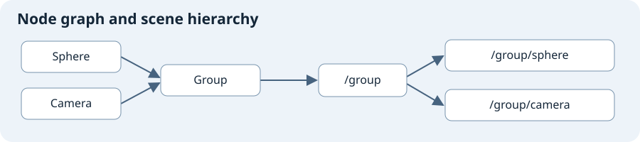

# Core Concepts Explained Simply

This page explains Gaffer's hardest ideas in plain English. It uses short sentences, everyday comparisons, and real visual effects (VFX) examples. Read this page if a technical director (TD) or manual uses a term that feels unclear.

## Contents

- [Node Graph vs. Scene Hierarchy](#node-graph-vs-scene-hierarchy)
- [Plugs vs. Attributes vs. Globals](#plugs-vs-attributes-vs-globals)
- [Filters and Sets](#filters-and-sets)
- [EditScopes](#editscopes)
- [Contexts and Context Variables](#contexts-and-context-variables)
- [Spreadsheets](#spreadsheets)
- [Universal Scene Description (USD) Layers and Scene Files](#usd-layers-and-scene-files)
- [Interactive Render, Batch Render, Outputs, and Render Passes](#interactive-render-batch-render-outputs-and-render-passes)
- [OpenColorIO and Color Management](#opencolorio-and-color-management)

## Node Graph vs. Scene Hierarchy

*Audience: New lighting artists moving from Maya or another digital content creation (DCC) app.*

### 1. One-Line Answer

The node graph is the recipe of steps, and the scene hierarchy is the 3D world that those steps build.

### 2. Analogy

Think of cooking dinner from a recipe card.

- **Where it works:** The recipe lists each step in order. Chop vegetables, fry onions, add sauce. That list is the node graph. The finished plate on the table is the scene hierarchy. You can look at the meal after step two or after step five.
- **Where it breaks:** A real meal disappears after you eat it. In Gaffer, you can jump back to any step and inspect the 3D scene at that exact point. You do not destroy the earlier state.

### 3. Teenager Explanation

A **node** is one box that does one job, such as loading a robot or adding a light. You connect nodes from top to bottom inside the **Graph Editor** (the workspace for nodes).

Gaffer does not keep one fixed 3D scene in memory like Maya does. Instead, Gaffer calculates the 3D scene on demand at the node you pick.

The **Hierarchy View** (the panel that lists 3D objects as a folder tree) shows the result at your focused node. Each item in that tree is a **scene location**, such as `/world/robot/arm`.

### 4. Feynman Check

New artists often click an empty area in the **Graph Editor** and panic because the 3D **Viewer** turns blank. Nothing vanished. Gaffer simply shows the scene at the node you focus on.

- **Pin the Viewer** (lock it to one output node) so your final scene stays visible while you edit earlier nodes.
- **Group** wraps inputs under a new parent folder, such as `/group/robot`. **MergeScenes** combines scenes without adding a new parent folder.

### 5. Why It Matters

In a VFX shot, you can inspect the raw animation cache at the top of the graph. One click lower, you inspect the same shot with shaders and lights. You find broken models or missing lights in seconds without opening a separate file.

## Plugs vs. Attributes vs. Globals

*Audience: Maya lighting artists and junior look development artists.*

### 1. One-Line Answer

A plug controls a node, an attribute describes a 3D object, and a global setting controls the whole render.

### 2. Analogy

Think of a movie theater projector room.

- **Where it works:** The dials on the projector machine are **plugs**. The ticket sticker on one specific seat is an **attribute** for that seat. The room lights switch and screen size are **globals** for the whole theater.
- **Where it breaks:** In Gaffer, an attribute on a parent folder flows down to every child object inside that folder. A sticker on a theater row does not copy itself onto every chair automatically.

### 3. Teenager Explanation

Maya calls node sliders "attributes", which confuses people in Gaffer. In Gaffer, those three words mean three separate things:

- **Plug:** A control field or wire socket on a node inside the **Node Editor**. Example: the `exposure` slider on a light node.
- **Attribute:** A property attached to a 3D scene location in the **Hierarchy View**. Example: turning camera visibility off on `/world/hero/cloak`, or assigning a surface shader. Child locations inherit attributes from their parent unless a child overrides them.
- **Globals:** Whole-scene settings that do not belong to one object. Examples: render camera, image resolution, frame rate, and output image files.

### 4. Feynman Check

Artists often look for a mesh's shader inside the **Node Editor** of a **SceneReader** node. You will not find it there. A **SceneReader** only shows file plugs.

To check which shader or visibility flag reached `/world/hero/cloak`, open the **Scene Inspector**. Select that location to inspect its evaluated scene data.

### 5. Why It Matters

In production, a studio template can turn off shadows on a parent folder `/world/fx`. Every smoke volume inside `/world/fx` inherits that attribute automatically. Knowing the difference between plugs, attributes, and globals lets you fix the exact layer instead of guessing.

## Filters and Sets

*Audience: Lighting and look development artists.*

### 1. One-Line Answer

A filter tells a node which 3D locations to change, and a set saves a named group of locations so you can reuse that selection.

### 2. Analogy

Think of shipping labels on warehouse boxes.

- **Where it works:** A **PathFilter** is a rule like "paint every box in aisle `/car/wheels/*`". A **Set** is a colored sticker like `shiny_metal` that you stick on boxes across different aisles. A **SetFilter** tells a node "paint every box with the `shiny_metal` sticker".
- **Where it breaks:** In a real warehouse, moving a box keeps its sticker. In Gaffer, an upstream **Group** node can change `/wheel` to `/car/wheel`. A **PathFilter** written for `/wheel` then stops matching.

### 3. Teenager Explanation

In Maya, you click objects in the viewport and click "Assign Material". In Gaffer, nodes do not know what you clicked ten minutes ago.

Instead, you plug a **Filter** node into the side of a processing node, such as **ShaderAssignment** or **StandardAttributes**.

- **PathFilter** matches locations by their path names. You can use `*` as a wildcard (a symbol that matches any name), such as `/robot/*/bolts`.
- **Set** stores a named list of locations, such as `hero_characters` or `key_lights`.
- **SetFilter** reads a set name (or combines sets with math like `characters - background`) and feeds those locations to any node.

### 4. Feynman Check

The most common beginner bug is a silent filter mismatch. Your **ShaderAssignment** node shows no error, yet the robot stays grey.

Always check the **Hierarchy View** right above the assignment node, not at the bottom of the graph. If a **Group** node sits below your assignment, the path `/group/robot` does not exist yet at the assignment node.

### 5. Why It Matters

A shot can hold 500 metal bolts across ten characters. You tag them once into a `chrome` set. Later, you reuse that same `chrome` set for shaders, shadow linking, and render passes without re-selecting paths.

## EditScopes

*Audience: Lighting artists and sequence leads.*

### 1. One-Line Answer

An **EditScope** is a clean container box in the node graph that stores your downstream overrides without changing the original asset or light rig.

### 2. Analogy

Think of laying tracing paper over an architect's blueprint.

- **Where it works:** You draw red corrections on the tracing paper. The original blueprint underneath stays untouched. If the director rejects your change, you lift the tracing paper off.
- **Where it breaks:** An **EditScope** does not only draw on top. Inside the box, Gaffer builds real nodes like **ShaderTweaks** or **Transform**. That happens whenever you adjust a light in the **Viewer** or **Light Editor**.

### 3. Teenager Explanation

Suppose a lead artist builds a lighting rig for twenty shots. You open shot `010` and want the key light 1 stop brighter.

If you edit the original light node directly, you break the shared rig. Instead, place an **EditScope** node lower in the graph and name it `ShotLighting`. Then select `ShotLighting` as the active scope in the **Viewer** or **Light Editor**.

Now, when you raise exposure in the **Light Editor**, Gaffer writes that single tweak inside the `ShotLighting` box. The original rig stays clean. You can disable, inspect, or delete your shot overrides at any time.

### 4. Feynman Check

Artists sometimes drag a light in the **Viewer** and wonder why nothing moves, or why an unexpected node changed.

Check the active **EditScope** dropdown at the top of the **Viewer** or **Light Editor**. If no **EditScope** is active, Gaffer edits the original source node directly (or locks the edit if the source sits inside a read-only reference).

### 5. Why It Matters

In a 30-shot TV sequence, a lead publishes one shared sequence rig. Each lighting artist works inside their own shot **EditScope**. When the lead updates the sky dome for the whole sequence, every shot picks up the new sky while keeping its own local tweaks.

## Contexts and Context Variables

*Audience: Lighting artists and technical directors (TDs).*

### 1. One-Line Answer

A context is a small dictionary of named values, such as the current frame or shot name, that changes how upstream nodes calculate their results.

### 2. Analogy

Think of a vending machine where the same mechanism serves different drinks based on the button code you press.

- **Where it works:** Pressing `A1` or `B2` does not rebuild the machine. It sends a different code up into the machine so the same mechanism delivers a different item. A context variable like `${shot}` works the same way.
- **Where it breaks:** People expect data to flow down the graph from top to bottom. **Scene data** flows down, but **context requests** flow *up* from bottom to top.

### 3. Teenager Explanation

Every time Gaffer asks a node for a scene, Gaffer hands that node a **Context**. By default, the context holds `${frame}` (the current timeline frame).

You can add your own **Context Variables**, such as `${shot}` set to `sh010` or `${renderPass}` set to `shadow`.

When a **SceneReader** file path says `/shows/film/${shot}/anim.usd`, Gaffer swaps `${shot}` for `sh010`. Change that one variable to `sh020`, and the exact same node graph loads shot 20 instead.

### 4. Feynman Check

This is the number one thing TDs and artists confuse: **where do I put a ContextVariables node?**

- Put **ContextVariables** *below* the nodes you want it to change, not above them.
- Why? When you view a node at the bottom, it asks the node above it for data. The **ContextVariables** node intercepts that upward request, swaps the variable, and asks the upstream nodes to compute with the new value.
- Also note: `scene:path` (the current 3D location path) does not exist in scene globals or inside individual shader nodes.

### 5. Why It Matters

Instead of maintaining 40 separate Maya scene files for 40 shots, a studio maintains one Gaffer graph. Switching the `${shot}` variable updates the camera, animation cache, light tweaks, and output EXR path in one click.

## Spreadsheets

*Audience: Lighting artists and TDs.*

### 1. One-Line Answer

A **Spreadsheet** node is a table that feeds different plug values into your graph depending on which row matches the current context.

### 2. Analogy

Think of a restaurant menu board that changes prices by day of the week.

- **Where it works:** You check today's day (the **selector**), scan down for a match, and read that row. Unlisted days use the default price.
- **Where it breaks:** In a Gaffer **Spreadsheet**, rows support wildcards like `sh0*`, and **the first matching row from the top wins**. If you put a broad wildcard row at the top, it hides every specific row below it.

### 3. Teenager Explanation

A **Spreadsheet** node has three simple parts:

1. **Selector:** A string value, usually a context variable like `${shot}` or `${renderPass}`.
2. **Rows:** Named cases, such as `sh010`, `sh020`, or `sh0*`, plus one **Default** row at the top.
3. **Columns:** Plugs you drag into the table, such as key light exposure, render resolution, or a node's on/off toggle.

You enable only the cells you want to override in each row. Disabled cells inherit from the **Default** row automatically.

### 4. Feynman Check

Never trust a single slider value when debugging a **Spreadsheet** without checking the active context.

- First, check which row has the active green indicator for your current context.
- Second, check row order: put specific rows (`sh010`) *above* wildcard rows (`sh0*`).
- Third, open the **Scene Inspector** at the bottom of the graph to verify the final value that reached the renderer.

### 5. Why It Matters

In an episodic animation show, 15 shots share one kitchen lighting rig. Shots `030` and `040` need a warmer rim light and higher motion blur samples. The lighting artist adds two rows in one **Spreadsheet** instead of forking the scene file.

## USD Layers and Scene Files

*Audience: Lighting artists and pipeline TDs.*

### 1. One-Line Answer

Universal Scene Description (USD) is an open scene format that stacks separate department files together like transparent sheets without overwriting earlier work.

### 2. Analogy

Think of old hand-drawn animation cels stacked on a light table.

- **Where it works:** The background sits on the bottom sheet. The character sits on the middle sheet. Shadows sit on the top sheet. Looking straight down shows the complete image, while each artist edits only their own sheet.
- **Where it breaks:** USD layers do not just add pixels on top. A higher layer can move a chair, swap a shader, or hide an object from a lower layer without copying the mesh file.

### 3. Teenager Explanation

Four USD words cover almost everything a lighting artist needs:

- **Prim:** One item in the USD tree, such as a mesh, camera, or light. Gaffer maps each USD prim to a scene location.
- **Layer:** One USD file on disk (`.usd`, `.usda`, or `.usdc`).
- **Stage:** The final combined 3D scene that you get after stacking all layers together.
- **Variant:** A built-in switch on an asset, such as switching a robot between `clean` and `damaged` looks.

In Gaffer, pick the right writer node for the job:

- **SceneReader:** Loads a `.usd`, `.abc` (Alembic), or `.scc` (Gaffer cache) scene into Gaffer.
- **USDLayerWriter:** Compares your base scene to your edited scene and saves *only the differences* as a tiny USD edit layer.
- **SceneWriter:** Writes the *entire* scene to a new file.

### 4. Feynman Check

New users often use **SceneWriter** when they only changed two materials. That copies gigabytes of mesh data into a new file and breaks updates when animation republishes.

Use **USDLayerWriter** when you want a lightweight lookdev or lighting override layer that stays connected to the original model. Use **SceneWriter** only when you intentionally need a full standalone cache.

### 5. Why It Matters

Modeling publishes `robot_geo.usdc` from Maya. Lookdev loads it in Gaffer, assigns Arnold shaders, and exports a 50-kilobyte `robot_look.usda` using **USDLayerWriter**. When modeling fixes a dent in `robot_geo.usdc`, lighting reloads the stage and gets both the fixed mesh and the existing shaders automatically.

## Interactive Render, Batch Render, Outputs, and Render Passes

*Audience: New lighting artists.*

### 1. One-Line Answer

**Outputs** defines what image channels to create, **InteractiveRender** previews them live in **Catalogue**, and **Render** plus a dispatcher writes final frames to disk.

### 2. Analogy

Think of a photo studio shoot.

- **Where it works:** **Outputs** is your shot list (full color photo, depth map, mask). **InteractiveRender** is the live monitor on set that updates as you move a lamp. **Catalogue** is the pinboard where you compare takes side by side. **Render** is the print lab that exports final high-resolution prints for the whole film.
- **Where it breaks:** In Gaffer, **Catalogue** does not plug into the bottom of your 3D scene wire. It sits beside the scene chain as an image node and listens for renders automatically.

### 3. Teenager Explanation

Beginners often add a light and click render, then see nothing. Four separate pieces must work together:

1. **StandardOptions:** Picks the render camera, resolution, and default renderer (such as Cycles or Arnold).
2. **Outputs:** Declares at least one image output (such as `Interactive > Beauty` for live preview, or `Batch > Beauty` for EXR files on disk).
3. **InteractiveRender** (live preview) or **Render** (final frames to disk): Sends the scene to the renderer.
4. **Catalogue** (for preview) or **LocalDispatcher** / farm dispatcher (for batch): Displays live images or executes frame sequences on disk.

To split a shot into layers (such as `hero`, `env`, and `shadow`), name them in **RenderPasses**. Use a **Spreadsheet** on `${renderPass}` to hide or matte objects per pass. Then connect **RenderPassWedge** to dispatch every pass together.

### 4. Feynman Check

Two mistakes stop almost every beginner:

- Connecting **Catalogue** into the 3D scene graph: it cannot connect there. Focus the **Viewer** on **Catalogue** directly to see your live render.
- Using **InteractiveRender** to save final shot frames: **InteractiveRender** is for live tweaking. Use **Render** connected to **LocalDispatcher** (or a render farm dispatcher like **FlamencoDispatcher** or **GafferDeadline**) to write final frames to disk.

### 5. Why It Matters

A compositor in Nuke needs separate EXR passes for the hero character, background, and contact shadow across frames `1001` to `1120`. With **RenderPasses**, **Outputs**, and **RenderPassWedge**, you click dispatch once and render every pass with matching settings.

## OpenColorIO and Color Management

*Audience: Lighting artists moving from sRGB workflows.*

### 1. One-Line Answer

OpenColorIO (OCIO) is the color translator that converts textures, render math, and your monitor display so colors look consistent across every app in the pipeline.

### 2. Analogy

Think of currency exchange when traveling between countries.

- **Where it works:** Textures arrive in different currencies (sRGB JPEG, linear EXR). OCIO converts them to one working currency (`ACEScg`) for light math. A **Display Transform** converts that result for your monitor so brightness looks right.
- **Where it breaks:** Applying a display transform twice (or missing an sRGB tag) clips highlights or washes out midtones. Raising light exposure cannot fix a wrong color tag.

### 3. Teenager Explanation

Since Gaffer 1.3, Gaffer uses the **ACES 1.3 Studio** OpenColorIO configuration by default (with **ACES 2.0** also bundled in Gaffer 1.7). Its default working color space is `ACEScg`, not legacy linear sRGB.

You control color management in three places:

- **Script Settings (`File > Settings`):** Picks the OCIO config and working space for the whole Gaffer file.
- **Viewer Display Transform:** Changes how your monitor displays the image without altering the actual pixel data.
- **OpenColorIOContext node:** Overrides the OCIO config or color variables for one branch of your graph.

### 4. Feynman Check

Artists coming from older sRGB setups often think Gaffer renders look "too contrasty" or "too dark" compared to Maya. Usually, the light is fine. Check two things first:

- Confirm that Gaffer and Maya use the exact same OCIO config and View transform (such as `ACES 1.0 - SDR Video`).
- Confirm that color textures (albedo) and data textures (roughness, normal, displacement) use the right input color space (`sRGB` vs. `Raw`).

### 5. Why It Matters

Gaffer automatically passes its native OCIO configuration to Arnold. When your lookdev renders match Nuke and your client review monitor automatically, you stop wasting hours debugging color shifts across departments.
