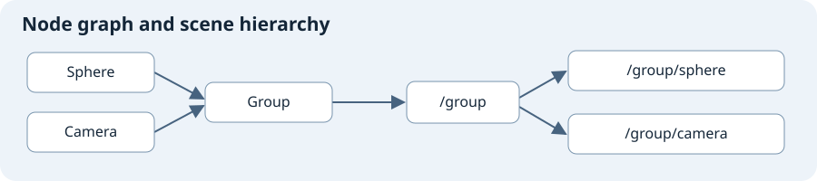

# Gaffer Glossary

Use these meanings for Gaffer 1.7.7.0. **Read** means the linked documentation supports the definition. For everyday analogies and examples, read [Core Concepts Explained Simply](core-concepts.md).

| Term | Meaning | Evidence |
| --- | --- | --- |
| Node | A unit in the node graph that performs an operation or contains other nodes. | Read: [Node Graph](https://www.gafferhq.org/documentation/1.7.7.0/WorkingWithTheNodeGraph/index.html) and [Node Reference](https://www.gafferhq.org/documentation/1.7.7.0/Reference/NodeReference/index.html). |
| Plug | A connection point or value field on a node inside the **Node Editor**. | Read: [Spreadsheet](https://www.gafferhq.org/documentation/1.7.7.0/WorkingWithTheNodeGraph/SpreadsheetNode/index.html). |
| Node graph | The nodes and their connections. Use the **Graph Editor** to edit it. | Read: [Controls and Shortcuts](https://www.gafferhq.org/documentation/1.7.7.0/Interface/ControlsAndShortcuts/index.html). |
| Scene | Data with a hierarchy of 3D locations and global render settings. | Read: [Anatomy of a Scene](https://www.gafferhq.org/documentation/1.7.7.0/WorkingWithScenes/AnatomyOfAScene/index.html). |
| Scene location | One position in the scene hierarchy, such as `/world/camera`. | Read: [Anatomy of a Scene](https://www.gafferhq.org/documentation/1.7.7.0/WorkingWithScenes/AnatomyOfAScene/index.html). |
| Scene hierarchy | The tree of scene locations. Use the **Hierarchy View** to inspect it. | Read: [Anatomy of a Scene](https://www.gafferhq.org/documentation/1.7.7.0/WorkingWithScenes/AnatomyOfAScene/index.html) and [Controls and Shortcuts](https://www.gafferhq.org/documentation/1.7.7.0/Interface/ControlsAndShortcuts/index.html). |
| Path | The slash-separated names that identify a scene location. | Read: [PathFilter](https://www.gafferhq.org/documentation/1.7.7.0/Reference/NodeReference/GafferScene/PathFilter.html). |
| Object | The 3D data at a scene location, such as a mesh or camera. A location can have no object. | Read: [Anatomy of a Scene](https://www.gafferhq.org/documentation/1.7.7.0/WorkingWithScenes/AnatomyOfAScene/index.html). |
| Attribute | A named property at a scene location (such as visibility or a shader) that child locations inherit. | Read: [Anatomy of a Scene](https://www.gafferhq.org/documentation/1.7.7.0/WorkingWithScenes/AnatomyOfAScene/index.html) and [StandardAttributes](https://www.gafferhq.org/documentation/1.7.7.0/Reference/NodeReference/GafferScene/StandardAttributes.html). |
| Globals | Whole-scene settings (such as camera, resolution, and outputs) that do not belong to one location. | Read: [Anatomy of a Scene](https://www.gafferhq.org/documentation/1.7.7.0/WorkingWithScenes/AnatomyOfAScene/index.html). |
| Filter | A node that selects scene locations for another node to process. | Read: [PathFilter](https://www.gafferhq.org/documentation/1.7.7.0/Reference/NodeReference/GafferScene/PathFilter.html) and [SetFilter](https://www.gafferhq.org/documentation/1.7.7.0/Reference/NodeReference/GafferScene/SetFilter.html). |
| Set | A named group of scene locations that multiple nodes can reuse. | Read: [Set](https://www.gafferhq.org/documentation/1.7.7.0/Reference/NodeReference/GafferScene/Set.html) and [Set Expressions](https://www.gafferhq.org/documentation/1.7.7.0/Reference/ScriptingReference/SetExpressions/index.html). |
| EditScope | A container node that stores downstream edits without modifying upstream rigs. | Read: [EditScope](https://www.gafferhq.org/documentation/1.7.7.0/Reference/NodeReference/Gaffer/EditScope.html). |
| Context | The named variables (such as frame or shot) that upstream nodes read when computing. | Read: [Contexts](https://www.gafferhq.org/documentation/1.7.7.0/WorkingWithTheNodeGraph/Contexts/index.html). |
| Spreadsheet | A node that uses a table to supply plug values for different context conditions. | Read: [Spreadsheet](https://www.gafferhq.org/documentation/1.7.7.0/WorkingWithTheNodeGraph/SpreadsheetNode/index.html). |
| Render pass | One named render variation (such as beauty or shadow) managed through `${renderPass}`. | Read: [RenderPasses](https://www.gafferhq.org/documentation/1.7.7.0/Reference/NodeReference/GafferScene/RenderPasses.html). |
| Catalogue | An image node that stores live renders for side-by-side comparison. | Read: [Catalogue](https://www.gafferhq.org/documentation/1.7.7.0/Reference/NodeReference/GafferScene/Catalogue.html). |
| Dispatcher | A node that runs batch render or cache tasks locally or on a render farm. | Read: [LocalDispatcher](https://www.gafferhq.org/documentation/1.7.7.0/Reference/NodeReference/GafferDispatch/LocalDispatcher.html) and [FlamencoDispatcher](https://www.gafferhq.org/documentation/1.7.7.0/Reference/NodeReference/GafferFlamenco/FlamencoDispatcher.html). |
| Renderer | The software that turns a 3D scene into images, such as Cycles, Arnold, RenderMan, or 3Delight. | Read: [InteractiveRender](https://www.gafferhq.org/documentation/1.7.7.0/Reference/NodeReference/GafferScene/InteractiveRender.html) and [Third-Party Setup](https://www.gafferhq.org/documentation/1.7.7.0/GettingStarted/ConfiguringGafferForThirdPartyTools/index.html). |
| Shader | A description of how a renderer shades a surface, volume, or light. | Read: [ArnoldShader](https://www.gafferhq.org/documentation/1.7.7.0/Reference/NodeReference/GafferArnold/ArnoldShader.html) and [ArnoldLight](https://www.gafferhq.org/documentation/1.7.7.0/Reference/NodeReference/GafferArnold/ArnoldLight.html). |
| Output | An image channel (beauty or AOV) that the **Outputs** node tells the renderer to produce. | Read: [Outputs](https://www.gafferhq.org/documentation/1.7.7.0/Reference/NodeReference/GafferScene/Outputs.html). |
| OpenColorIO (OCIO) | The color management system that maps textures, working spaces, and monitor transforms. | Read: [OpenColorIOContext](https://www.gafferhq.org/documentation/1.7.7.0/Reference/NodeReference/GafferImage/OpenColorIOContext.html). |
| Universal Scene Description (USD) | An open scene format that stacks non-destructive department files into one 3D stage. | Read: [OpenUSD Introduction](https://openusd.org/release/intro.html) and [GafferUSD](https://www.gafferhq.org/documentation/1.7.7.0/Reference/NodeReference/GafferUSD/index.html). |
