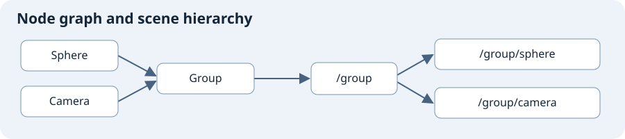

# Gaffer Glossary

Use these meanings for Gaffer 1.7.6.0. **Read** means the linked documentation supports the definition. **Unchecked** means the project still needs evidence.

| Term | Meaning | Evidence |
| --- | --- | --- |
| Node | A unit in the node graph that performs an operation or contains other nodes. | Read: [Node Graph](https://www.gafferhq.org/documentation/1.7.6.0/WorkingWithTheNodeGraph/index.html) and [Node Reference](https://www.gafferhq.org/documentation/1.7.6.0/Reference/NodeReference/index.html). |
| Plug | A connection point for a value on a node. | Read: [Spreadsheet](https://www.gafferhq.org/documentation/1.7.6.0/WorkingWithTheNodeGraph/SpreadsheetNode/index.html). |
| Node graph | The nodes and their connections. Use the **Graph Editor** to edit the node graph. | Read: [Controls and Shortcuts](https://www.gafferhq.org/documentation/1.7.6.0/Interface/ControlsAndShortcuts/index.html). |
| Scene | Data with a hierarchy and global settings. | Read: [Anatomy of a Scene](https://www.gafferhq.org/documentation/1.7.6.0/WorkingWithScenes/AnatomyOfAScene/index.html). |
| Scene location | One position in the scene hierarchy. | Read: [Anatomy of a Scene](https://www.gafferhq.org/documentation/1.7.6.0/WorkingWithScenes/AnatomyOfAScene/index.html). |
| Scene hierarchy | The tree of scene locations. Use the **Hierarchy View** to inspect it. | Read: [Anatomy of a Scene](https://www.gafferhq.org/documentation/1.7.6.0/WorkingWithScenes/AnatomyOfAScene/index.html) and [Controls and Shortcuts](https://www.gafferhq.org/documentation/1.7.6.0/Interface/ControlsAndShortcuts/index.html). |
| Path | The names that identify a scene location, with slashes between the names. | Read: [PathFilter](https://www.gafferhq.org/documentation/1.7.6.0/Reference/NodeReference/GafferScene/PathFilter.html). |
| Object | The data at a scene location that represents an item, such as a mesh or camera. A location can have no object. | Read: [Anatomy of a Scene](https://www.gafferhq.org/documentation/1.7.6.0/WorkingWithScenes/AnatomyOfAScene/index.html). |
| Globals | Scene data that does not belong to an individual location. | Read: [Anatomy of a Scene](https://www.gafferhq.org/documentation/1.7.6.0/WorkingWithScenes/AnatomyOfAScene/index.html). |
| Filter | A node that selects scene locations for another node to process. | Read: [PathFilter](https://www.gafferhq.org/documentation/1.7.6.0/Reference/NodeReference/GafferScene/PathFilter.html) and [ShaderAssignment](https://www.gafferhq.org/documentation/1.7.6.0/Reference/NodeReference/GafferScene/ShaderAssignment.html). |
| Context | The variables that a node operation receives, such as the frame. | Read: [Contexts](https://www.gafferhq.org/documentation/1.7.6.0/WorkingWithTheNodeGraph/Contexts/index.html). |
| Spreadsheet | A node that uses a table to supply plug values for different conditions. | Read: [Spreadsheet](https://www.gafferhq.org/documentation/1.7.6.0/WorkingWithTheNodeGraph/SpreadsheetNode/index.html). |
| Catalogue | An image node that stores images for review. | Read: [Catalogue](https://www.gafferhq.org/documentation/1.7.6.0/Reference/NodeReference/GafferScene/Catalogue.html). |
| Renderer | The software that makes an image from a scene. Arnold and Cycles are examples. | Read: [InteractiveRender](https://www.gafferhq.org/documentation/1.7.6.0/Reference/NodeReference/GafferScene/InteractiveRender.html) and the [Arnold setup guide](https://www.gafferhq.org/documentation/1.7.6.0/GettingStarted/ConfiguringGafferForThirdPartyTools/index.html). |
| Shader | A description of how a renderer treats a surface or light. | Read: [ArnoldShader](https://www.gafferhq.org/documentation/1.7.6.0/Reference/NodeReference/GafferArnold/ArnoldShader.html) and [ArnoldLight](https://www.gafferhq.org/documentation/1.7.6.0/Reference/NodeReference/GafferArnold/ArnoldLight.html). |
| Output | An image that a renderer must produce, as defined by the **Outputs** node. | Read: [Outputs](https://www.gafferhq.org/documentation/1.7.6.0/Reference/NodeReference/GafferScene/Outputs.html). |
| Universal Scene Description (USD) | A system for describing and composing scenes. | Read: [OpenUSD introduction](https://openusd.org/release/intro.html) and [GafferUSD](https://www.gafferhq.org/documentation/1.7.6.0/Reference/NodeReference/GafferUSD/index.html). |
