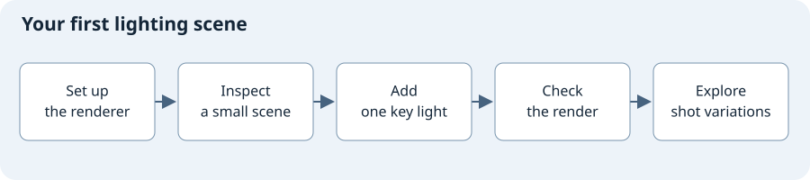

# Learning Path for Maya Lighting Artists

This route walks you through the resource list one small task at a time. Prove each step works before you add complexity. You do not need Python or an Arnold license for your first scene. Read [Core Concepts Explained Simply](core-concepts.md) whenever a term feels unclear.

## 1. Install Gaffer and Render a First Frame

Open [Installation and Renderers](../README.md#installation-and-renderers). Install Gaffer on Windows, Linux, or macOS. Built-in Cycles works right away with no extra setup.

If your studio requires Arnold, follow the [Arnold Setup Checklist](arnold-setup.md) after you confirm Gaffer launches cleanly.

Finish line: Gaffer opens, your chosen renderer loads, and a test image reaches **Catalogue**. Treat installation, renderer selection, and image display as three separate checks.

## 2. Learn the Two Maps

Read [Node Graph vs. Scene Hierarchy](core-concepts.md#node-graph-vs-scene-hierarchy), [Anatomy of a Scene](https://www.gafferhq.org/documentation/1.7.7.0/WorkingWithScenes/AnatomyOfAScene/index.html), and [Maya to Gaffer](maya-to-gaffer.md).

Create a **Sphere**, inspect its hierarchy, then connect it to **Transform**. Focus each node in turn. The **Graph Editor** shows operations; the **Hierarchy View** shows the 3D scene they build.

Watch chapter 1 of [Trixter Basics](video-notes.md#trixter-the-basics), or Schneider's inspection sections in [Introduction and Arnold](video-notes.md#arvid-schneider-introduction-and-arnold). Pin the **Viewer** to the bottom node, then select a shader node and confirm the visible scene stays steady.

Finish line: You can locate an object path, pin the **Viewer**, and explain why an upstream node shows an earlier state of the scene.

## 3. Assemble a Tiny Scene

Complete the [GafferBot tutorial](https://www.gafferhq.org/documentation/1.7.7.0/GettingStarted/TutorialAssemblingTheGafferBot/index.html) using built-in Cycles first. Do not mix Cycles shaders with an Arnold render; switch both shaders and lights together when you test Arnold later.

Finish line: One asset, one shader, one camera, and one light produce a live image in **Catalogue**. Save the `.gfr` file and note its external cache paths.

## 4. Light With an Intention

Use [Lighting and Look Development](../README.md#lighting-and-look-development). Pick a reference photo and describe the mood in one sentence. Set the key light angle first. Adjust exposure, then light size, one change at a time. Add fill only when a visible shadow needs lift.

Watch the lighting chapter of [Schneider's shading and lighting tutorial](video-notes.md#arvid-schneider-shading-and-lighting). Place an **EditScope** downstream, select it in the **Light Editor**, and confirm your light changes land inside that **EditScope** box.

Finish line: Save two lighting snapshots in **Catalogue** with the same camera and OpenColorIO display transform. Explain what changed. Raising exposure by 1 stop doubles emitted light energy, though the display transform compresses bright highlights.

## 5. Target an Edit and Batch Render

Read [Filters and Sets](core-concepts.md#filters-and-sets), plus **ShaderAssignment**, **PathFilter**, **Set**, and **SetFilter** in [Artist Learning](../README.md#artist-learning). Give two objects different names and assign a material to only one. Inspect paths right above the assignment node, especially after a **Group** node.

Watch the assignments chapter of [Trixter Basics](video-notes.md#trixter-the-basics). Then connect a **Render** node to **LocalDispatcher**, add a `Batch > Beauty` output in **Outputs**, and write one EXR frame to disk.

Finish line: Only the intended object changes. Break the filter on purpose, diagnose the path mismatch, fix it, and write one final frame to disk.

## 6. Understand a Scene Handoff

Read Universal Scene Description (USD) basics in [USD Layers and Scene Files](core-concepts.md#usd-layers-and-scene-files) and [Artist Foundations](../README.md#artist-foundations). Know what a prim, layer, and stage mean before you export changes.

Finish line: Explain what **SceneReader** loads, when **SceneWriter** exports a full scene, and when **USDLayerWriter** writes a small override layer. Reload your exported layer into a fresh graph to verify it.

## 7. Share a Graph Across Shots

Read [Contexts](core-concepts.md#contexts-and-context-variables) and [Spreadsheets](core-concepts.md#spreadsheets), then finish the [Spreadsheet tutorial](https://www.gafferhq.org/documentation/1.7.7.0/WorkingWithTheNodeGraph/TutorialSettingUpASpreadsheet/index.html). Start with one light plug and two rows. Inspect the selector and default row before you add a shot context variable.

Watch the context and spreadsheet chapters of [Trixter Intermediate](video-notes.md#trixter-intermediate). Switch two light looks before you study a studio template. Put a wildcard row above a specific row on purpose to see first-match priority, then fix the order.

Finish line: One named row changes one light value cleanly. You can explain what selects the row, which row wins, and what happens when no row matches.

## 8. Rebuild Without Notes

Take a short break, then rebuild a tiny scene from scratch without instructions. Swap in a different asset, break one filter or camera path on purpose, and fix it with **Scene Inspector**.

## Optional Next Steps

- **Render passes:** Create two passes with **RenderPasses** (`hero` and `shadow`), vary visibility with a **Spreadsheet** on `${renderPass}`, and dispatch both with **RenderPassWedge**.
- **Procedural look development:** Practice [Schneider's dragon tutorial](video-notes.md#arvid-schneider-shading-and-lighting) with licensed sample geometry. Inspect a greyscale mask before you mix two materials.
- **Reusable tools and scripting:** Read the **Box Node** guide and the **Python Scripting API** tutorials in [Technical Learning](../README.md#technical-learning) to package controls and automate repetitive tasks.
- **Studio case studies:** Browse [Vimeo company talks](vimeo-resources.md#company-production-talks) after your first render works. Treat older talks as architectural context rather than exact 1.7.7.0 steps.

The video notes separate caption findings, publisher chapters, and proposed drills. None of those notes replace a hands-on test in Gaffer 1.7.7.0.
