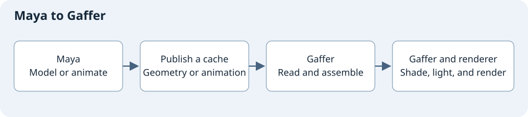

# Maya to Gaffer

Use familiar Maya questions to find the matching Gaffer tool. These pairs compare purpose, not identical behavior.

**Important warning for Maya users:** A Maya "Attribute" (a control slider in the Attribute Editor) is a **Plug** in Gaffer. A Gaffer **Attribute** is a property attached to a 3D scene location (such as visibility or shader assignment) that flows down to child locations. Read [Plugs vs. Attributes vs. Globals](core-concepts.md#plugs-vs-attributes-vs-globals) for an everyday comparison.

| Artist question | Maya landmark | Gaffer starting point |
| --- | --- | --- |
| What objects exist in this scene? | Outliner | **Hierarchy View**, inspecting the scene output you focus on. |
| What controls this node? | Attribute Editor | **Node Editor** for the selected node's plugs. |
| What final value reached this object? | Evaluated attributes and connections | **Scene Inspector** at the relevant output and scene location. |
| Where is the material network? | Hypershade | Shader nodes connected to **ShaderAssignment** (or tweaked with **ShaderTweaks**). |
| Which objects receive this edit? | Viewport selection or sets | A **Filter** (**PathFilter** or **SetFilter**) matching scene locations. |
| How do I adjust lights in one table? | Light Editor | **Light Editor** paired with an active **EditScope**. |
| How do I link lights to objects? | Relationship Editor | **Light Linking** via **StandardAttributes** and named **Sets**. |
| Which camera and resolution render? | Render Settings (Common) | **StandardOptions** global scene options. |
| Which Arnold settings apply? | Arnold Render Settings | **ArnoldOptions** after you pick Arnold in **StandardOptions**. |
| How do I set up render layers and AOVs? | Render Setup and AOVs | **RenderPasses**, **Render Pass Editor**, and **Outputs**. |
| Where is the live preview image? | Arnold RenderView | **InteractiveRender** plus **Outputs** and **Catalogue**. |
| How do I render final frames to disk? | Batch Render | **Render** connected to **LocalDispatcher** or a farm dispatcher. |
| How do shots vary? | Scene overrides or separate files | **EditScope** for hand tweaks, or **Spreadsheet** rows driven by **Contexts**. |
| Where is color management? | Color Management Preferences | Script Settings OpenColorIO (ACES 1.3 Studio default) and **OpenColorIOContext**. |

A node is an operation. A scene location is a 3D item that the graph builds. **Group** adds a new parent folder, whereas **MergeScenes** keeps existing paths intact. Inspect the **Hierarchy View** right above a filter before you type a path or choose a render camera.

References: [Core Concepts Explained Simply](core-concepts.md), [Anatomy of a Scene](https://www.gafferhq.org/documentation/1.7.7.0/WorkingWithScenes/AnatomyOfAScene/index.html), [Controls and Shortcuts](https://www.gafferhq.org/documentation/1.7.7.0/Interface/ControlsAndShortcuts/index.html), and [SceneInspector source](https://github.com/GafferHQ/gaffer/blob/1.7.7.0/python/GafferSceneUI/SceneInspector.py).
